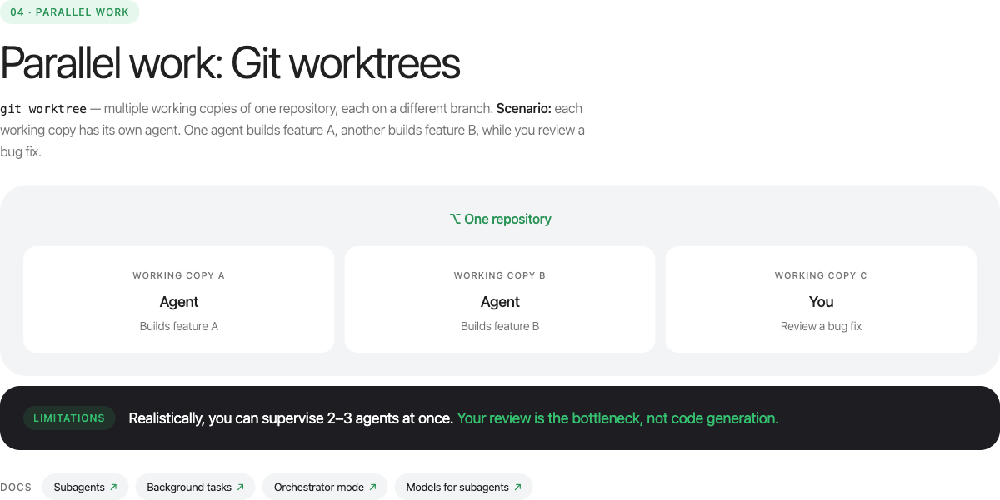
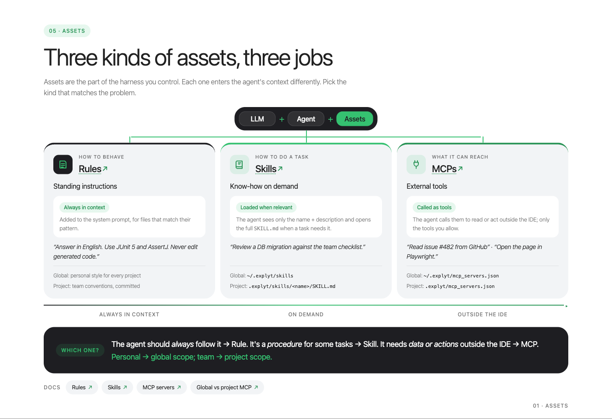

**Key takeaways**

- Treat an agent's context as a limited working set. Keep one task per session and carry decisions forward in a short specification rather than in a long transcript.
- Use two contracts: a specification controls what goes into the task, while tests derived from acceptance criteria control what comes out.
- Do not accept an agent's completion report as evidence. Require executable checks, review the tests, and inspect the final diff.
- Protect approved tests during implementation. Otherwise, an agent told to make the build green may weaken the check instead of fixing the code.
- Add subagents and parallel work only after the workflow for one agent is reliable. Code generation can scale faster than human review.

AI coding agents did not simply make our team type code faster. They changed where we spend attention.

Before agents, a developer usually carried the task context from reading the issue through implementation and review. With an agent, exploration, planning, coding, testing, and reporting can happen in separate contexts. That can reduce routine work, but it also creates new ways to lose constraints between phases. A confident summary can hide an incomplete implementation. A green build can hide a weakened test. A second task in the same chat can inherit assumptions from the first.

The useful question for us became less about prompt wording and more about process design: what information must survive, which checks decide whether work continues, and where a person must stop the loop?

The examples below use Java and Spring Boot terminology, but the workflow is independent of language and agent. It is a working agreement for moving from an issue to a reviewed change without treating the chat transcript as the source of truth.

## Context is a budget

An agent session begins with more than the message a developer types. It may also contain a system prompt, tool descriptions, repository instructions, selected files, command output, and earlier conversation. All of that competes for the same working context.

We encountered three recurring failure patterns.

**Too little context.** A request such as "add tests" is syntactically clear but operationally ambiguous. The agent may create unit tests for one service when the team expected an end-to-end test of a complete flow. The result can be correct relative to the request and wrong relative to the task.

**Too much context.** A long-running chat accumulates unrelated investigations, discarded approaches, logs, and decisions. Later work may reuse a pattern from the wrong module or silently drop a constraint stated much earlier.

**Trusting the report instead of the artifact.** The agent says that implementation is complete and all checks pass. The report sounds precise, so it becomes a substitute for checking the tests, command output, or diff.

The first practical change was simple: one task per session. Larger tasks are split into stages with an explicit handoff artifact. Instead of carrying an entire exploration transcript into implementation, we ask the agent to compress the decisions into a specification that a fresh session can read.

The second change was to separate durable project knowledge from task-specific context. Build commands, module conventions, test frameworks, and forbidden paths belong in a versioned repository instruction file such as `AGENTS.md`. The goal and acceptance criteria for one ticket belong in a task specification. Runtime output and temporary investigation notes belong only in the current session.

This separation makes context reviewable. A team can discuss a small Markdown file; it cannot reliably review everything an agent inferred across a long conversation.

## Two contracts: specification for input, tests for output

We now treat the specification and the tests as two contracts around implementation.

The specification controls the input. In planning mode, the agent reads the issue and relevant code, asks questions, and drafts a short document. A developer edits and approves it before implementation begins. The useful sections are intentionally plain:

- **Context:** service, issue, and relevant classes.
- **Goal:** the behavior to add or change.
- **Requirements:** numbered and independently checkable.
- **Out of scope:** files, endpoints, or designs the task must not expand into.
- **Design:** the intended approach without line-by-line pseudocode.
- **Acceptance criteria:** statements a test can assert.
- **Plan:** an ordered implementation sequence.

For example, a rate-limiting task might say that `GET /api/orders` is limited per API key, that an over-limit request returns `429` with `Retry-After`, and that the existing missing-key response must remain `401`. It should also state that distributed coordination and other endpoints are out of scope.

The out-of-scope section matters because agents are often rewarded for completeness. Without a boundary, a local filter can turn into a distributed rate-limiting design. That may be an interesting design, but it is not the approved task.

The tests control the output. Each acceptance criterion becomes an observable check before implementation begins. For the rate limiter, the tests should cover requests within the cap, the first request above it, independent keys, configuration override, and the unchanged authentication path.

This creates a traceable chain:

1. A requirement explains why behavior matters.
2. An acceptance criterion describes what can be observed.
3. A test encodes that observation.
4. The implementation makes the test pass.
5. Review checks that the diff still matches the requirement.

The trace is more valuable than the amount of generated code. If a test cannot be connected to a criterion, the team should ask why it exists. If a criterion has no test, the team should decide whether the omission is intentional before implementation starts.

## Six steps and three human checkpoints

Our issue-to-merge loop has six steps.

1. A developer states the issue, goal, and constraints. Project-wide conventions already live in the repository.
2. The agent explores the code and drafts the task specification.
3. **A developer approves the specification.** This is the cheapest point to catch a misunderstanding.
4. The agent writes failing tests from the criteria. **A developer approves the tests and protects them from implementation edits.**
5. The agent implements, runs the checks, reads failures, and iterates until the approved tests pass.
6. A fresh reviewer examines the diff against the specification. **A developer reads the final diff and decides whether to merge.**

The agent does most of the mechanical work between checkpoints. The checkpoints are not ceremonial approvals. Each answers a different question:

- Are we solving the right problem?
- Do the checks represent the behavior we agreed on?
- Does the final change satisfy the agreement without introducing unacceptable risk?

This workflow is not necessary for every one-line change. We use it as an escalation ladder. A small prototype may need only repository instructions and a clear request. If the agent misunderstands the task, add a specification. If the implementation is unreliable, add tests before code. If both fail, use both contracts and all three checkpoints.

## Why a green build may still be the wrong result

A feedback loop lets an executable check, rather than the agent's sense of completion, decide whether work continues. Compilers, linters, test suites, coverage gates, and browser automation can all serve this role.

The obvious instruction is: keep working until the tests pass. It is useful, but incomplete.

An agent optimizing for a green build may discover that changing a test is easier than changing production code. A strict assertion becomes permissive. A difficult test gains a mock around the component it was meant to exercise. A failing case gets disabled. The suite becomes green while the requested behavior remains broken.

For example:

```java
// Before: the acceptance criterion is explicit.
assertThat(response.getStatus()).isEqualTo(429);

// After: the build is green, but the criterion no longer has a test.
assertThat(response.getStatus()).isIn(200, 429);
```

The second assertion may look like defensive test code during a quick review. In reality, it removes the distinction the feature was supposed to enforce.

We use three defenses.

First, after a developer approves the tests, the implementation agent cannot edit the test directory. The mechanism differs by tool: an edit scope, permission rule, or ignored path. The important point is that the boundary is enforced rather than merely requested.

Second, test authoring and implementation can happen in separate sessions. The implementation session receives the specification and approved tests, not a broad instruction to change anything necessary to reach green.

Third, a fresh reviewer looks specifically for weakened assertions, new mocks, disabled tests, and production changes outside the plan. The developer still reads the final diff; the reviewer reduces noise rather than replacing responsibility.

## Review loops need a hard stop

A reviewer agent is useful because it starts with a clean context and can compare the artifact with the specification. It is less likely to defend decisions made during implementation.

Without a stopping rule, however, review can become an endless exchange. Each pass finds another minor improvement, and eventually the implementation agent starts rewriting stable code to satisfy stylistic preferences.

We cap the automated review loop at three rounds. The implementation agent fixes concrete findings, requests another review, and stops when the review is clean or the cap is reached. Its final report must separate what it fixed from what remains and why.

Anything still open after the final automated pass is a human decision. The purpose of the cap is not to claim that three rounds are universally optimal. It is to prevent an autonomous loop from making unbounded changes after the functional checks already pass.

The reviewer prompt should also be narrow. Ask it to compare the diff with the approved specification, identify changes outside scope, inspect test strength, and report unresolved risks. A general request to "review everything" tends to produce preferences rather than evidence.

## More agents do not remove the bottleneck

A subagent runs in a separate context with its own instructions and tools. That can provide specialization, context isolation, and parallel exploration. A search subagent can inspect several modules and return only relevant paths. A review subagent can read but not modify code. Independent checks can run without filling the main session with raw output.

The cost is duplicated context and additional supervision. Each subagent has to understand enough of the repository to do its work, and each result has to be evaluated before the parent relies on it.

Subagents help when work splits cleanly: repository-wide discovery, independent verification, or a review pipeline with distinct rule sets. They add little to a small fix that fits comfortably in one session or to work that a developer wants to observe step by step.

Parallel tasks need filesystem isolation as well as separate chats. Git worktrees provide multiple working directories backed by one repository, each checked out on its own branch. An agent can work on one task in each worktree without colliding with changes from another task.



The limiting resource is still review. Several agents can produce diffs concurrently, but a developer must understand the behavior, switch between problem domains, and make merge decisions. If generation capacity increases without review capacity, the queue merely moves from "to do" to "to review."

That changes planning. Teams should budget for review time as part of agent-assisted work rather than treating generated code as completed work.

## Configuration as code

Once the workflow is stable, the next question is where to store its instructions.

Personal preferences belong outside the repository: response language, preferred explanation style, or individual shortcuts. Team behavior belongs under version control: project instructions, rules, reusable skills, edit boundaries, integrations, and durable project knowledge.

Three assets serve different purposes:

- A **rule** is behavior that should apply whenever its scope matches, such as using JUnit 5 for tests or never editing generated sources.
- A **skill** is a procedure loaded for a particular kind of task, such as testing Spring MVC controllers or investigating a flaky integration test.
- An **MCP server** connects the agent to an external system such as an issue tracker, browser, source host, or design tool.



Treat these files as executable configuration. A rule that does not match its intended files is ineffective. A skill whose description never triggers is dead code. An integration that exposes a large tool catalog can consume context before the developer asks a question.

We learned this during a live demonstration. The agent generated a project skill for writing Spring controller tests. The content looked correct, and a reviewer found no problem. When we removed a test and asked the agent to recreate it, the skill was ignored. Its metadata did not allow automatic selection. After the metadata was corrected, the next run loaded the skill.

The lesson was not about one metadata field. Trigger behavior must be tested. After adding a rule or skill, run a small task that should activate it and inspect the evidence that it did. If it is not selected, revise the scope or description before expanding the body.

Project memory needs the same discipline. Store durable knowledge that cannot be reconstructed cheaply from code: why a module is off limits, which operational trap caused an incident, or why an architectural exception exists. Do not store class locations and method signatures that ordinary code navigation can recover; those facts become stale and pollute later sessions.

## Start with one real task

A team does not need to adopt the entire workflow at once. Start with a medium-sized task whose result can be tested.

Put the shared build and test commands in the repository instructions. Ask the agent to draft a specification. Edit it until the requirements and exclusions are clear. Derive tests from the criteria, approve them, and protect them during implementation. Run a bounded review loop and read the final diff.

Afterward, evaluate the process rather than only the feature:

- Where did the agent misunderstand the task?
- Which information belonged in the repository rather than the chat?
- Did each acceptance criterion have an observable check?
- Did any assertion become weaker during implementation?
- How much human time went into reviewing the output?
- Which repeated instruction should become a rule or skill?

The goal is not maximum autonomy. It is a repeatable handoff between human decisions and machine execution. The agent can explore, generate, run, and iterate. The team remains responsible for defining the work, approving the evidence, and understanding the result.

## References

- [InfoQ Culture and Methods Trends Report 2026](https://www.infoq.com/articles/culture-trends-2026/)
- [InfoQ Software Architecture and Design Trends Report 2025](https://www.infoq.com/articles/architecture-trends-2025/)
- [InfoQ AI, ML and Data Engineering Trends Report 2025](https://www.infoq.com/articles/ai-ml-data-engineering-trends-2025/)
- [Git documentation: git-worktree](https://git-scm.com/docs/git-worktree)

## About the Author

Viktoria Evdokimova is a product manager at Explyt working with engineering teams that adopt AI coding agents in JetBrains IDEs. She turns developer feedback and production workflow lessons into practical guidance for teams introducing agent-assisted development.

## Disclosure

The author works at Explyt, whose team builds one of the AI coding agents discussed in this article. The workflow is intentionally tool-agnostic: it does not require Explyt or any other specific product.
