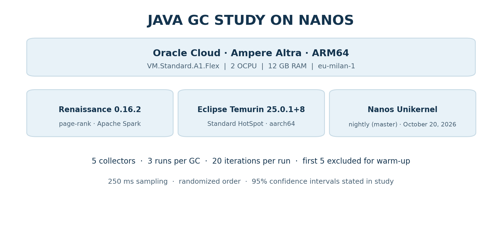
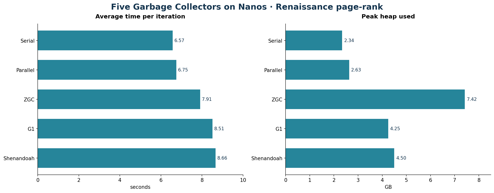
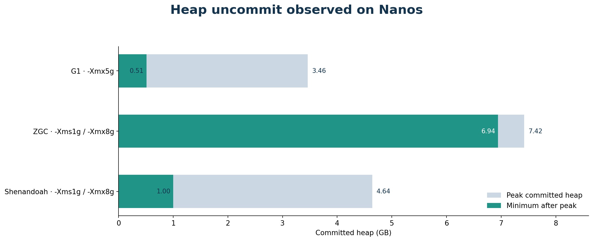
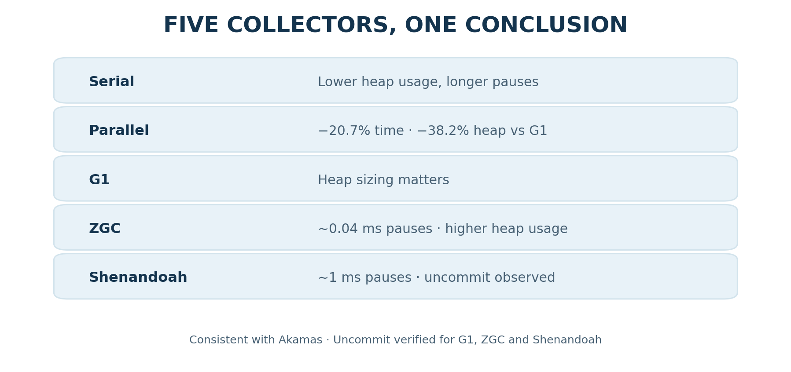

*Building on Akamas's “Choosing the right GC for maximum performance” study: Eclipse Temurin 25, Renaissance, and Nanos on Oracle Cloud ARM64.*

## Still skeptical about running the JVM on a unikernel?

A full JVM on a unikernel? With five major HotSpot garbage collectors, dynamic heap management, and advanced memory uncommit capabilities?

The question is no longer simply whether Java can run on Nanos, but **how much of the JVM behavior we know and rely on every day is preserved in this environment**.

To find out, we put Eclipse Temurin 25 to the test on Nanos, reproducing the experiments from Akamas's *Choosing the right GC for maximum performance* study and verifying heap uncommit with G1, ZGC, and Shenandoah.

The results? Five working garbage collectors, the same fundamental trade-offs between throughput, memory, and pauses, and the ability to reduce committed heap during execution.

**Running the JVM on Nanos is more than a proof of concept. It is an environment where we can apply and validate familiar JVM tuning strategies.**

## Introduction

Do we still need to choose and tune the JVM's garbage collector, or are recent Java releases smart enough to select the best configuration on their own?

Akamas explored this question in [Choosing the right GC for maximum performance](https://akamas.io/resources/right-app-gc-maximum-performance/), comparing HotSpot garbage collectors on Linux using the Renaissance `page-rank` benchmark, based on Apache Spark. Their conclusion was clear: **there is no single best garbage collector**. In their experiment, switching from G1 to Parallel GC reduced execution time by **22%** and memory usage by **30%**.

We used that study as a starting point to answer two questions about [Nanos](https://nanovms.com/):

1. **Do the five selected garbage collectors work on Nanos with a standard Temurin distribution?** Specifically, Serial, Parallel, G1, ZGC, and Shenandoah, without JVM or collector modifications.
2. **Does Nanos support memory uncommit?** In other words, can the JVM release heap memory it no longer needs back to the system?

The Akamas study provides a reference point: if collectors on Nanos exhibit behaviors and trade-offs similar to those described by Akamas, we have experimental evidence that the features exercised by this benchmark are supported.

> **Results at a glance:** All five collectors run on Nanos and reproduce the main trends observed by Akamas on Linux. As in the Akamas study, Parallel GC is faster than G1 and uses less heap, on Nanos reducing execution time by **20.7%** and peak heap usage by **38.2%**; on Nanos it is also faster than ZGC and Shenandoah. ZGC achieves pauses of approximately **0.04 ms**. Heap uncommit works on Nanos: G1 releases memory, and ZGC and Shenandoah also release memory when uncommit is enabled.

## 1. Experimental Environment

| Component | Version or configuration |
|---|---|
| Unikernel | Nanos nightly build (master) of October 20, 2026, downloaded by Ops with `-n`/`--nightly` |
| JVM | Eclipse Temurin 25.0.1+8 JRE, Linux aarch64 |
| Benchmark | Renaissance 0.16.2, `page-rank` |
| Framework | Apache Spark, local mode |
| Cloud | Oracle Cloud Infrastructure, `eu-milan-1` |
| Instance | `VM.Standard.A1.Flex`, Ampere Altra ARM64, 2 OCPU, 12 GB RAM |
| Collectors | Serial, Parallel, G1, ZGC, Shenandoah |

Nanos was run through the `ops` command, using the `-n` (`--nightly`) option so that the nightly kernel image is downloaded instead of the latest release.

The JVM is a standard HotSpot distribution for Linux aarch64: no changes to the collectors or to the JVM itself. Collectors are selected using standard flags.

| Collector | Flag |
|---|---|
| Serial | `-XX:+UseSerialGC` |
| Parallel | `-XX:+UseParallelGC` |
| G1 | `-XX:+UseG1GC` |
| ZGC | `-XX:+UseZGC` |
| Shenandoah | `-XX:+UseShenandoahGC` |

### Infographic 1 — Experimental Setup

## 2. Five Garbage Collectors, All Working

We compared Serial, Parallel, G1, ZGC, and Shenandoah with **8 GB of memory**. Each collector was tested with **3 independent JVM launches** and **20 iterations per launch**, excluding the first **5** as warm-up, with a randomized experiment order.

The first finding is qualitative: **all five collectors start successfully, complete the benchmark, and behave as expected**. This is not trivial. ZGC and Shenandoah, in particular, require nontrivial kernel memory-management capabilities: multiple mappings of the same physical memory, reservation of large virtual address spaces, and runtime memory commit and release.

| Collector | Time vs G1 | CPU vs G1 | Peak heap vs G1 | Maximum pause |
|---|---:|---:|---:|---:|
| Serial | **−22.8%** | −8.1% | **−45.0%** | 583–652 ms |
| Parallel | −20.7% | −6.2% | −38.2% | 248–259 ms |
| ZGC | −7.1% | −7.3% | +74.6% | **0.04 ms** |
| G1 (baseline) | 8.51 s | 1.63 cores | 4.25 GB | 257–294 ms |
| Shenandoah | +1.8% | +0.3% | +5.8% | ~1 ms |

*Memory means peak heap usage across the full execution, not total resident RAM. Maximum pause is reported as the range between the minimum and maximum observed across the three launches.*

### Infographic 2 — Execution Time and Heap Usage on Nanos

The values are derived from the G1 baseline and the percentage changes, with rounding. Maximum pauses remain in the preceding table to avoid placing sub-millisecond values and pauses lasting hundreds of milliseconds on the same scale.

**No collector simultaneously minimizes execution time, heap usage, and pauses.** This is the general conclusion reached by Akamas.

### Parallel GC: Akamas's Main Finding Is Reproduced

Compared with G1, Akamas observed **22% less execution time** and **30% less memory usage**. On Nanos, we measured **20.7% less execution time** and **38.2% less peak heap usage**. The direction and order of magnitude agree, despite differences in hardware, architecture, and HotSpot version.

### Serial GC

Serial reduces peak heap usage by **45%**, consistent with Akamas, where it used roughly half as much memory as G1.

### ZGC: Minimal Pauses, More Heap

ZGC records maximum pauses of approximately **0.04 ms**, with peak heap usage **74.6% higher** than G1; Akamas observed **+67%**. Notably, ZGC in JDK 25 is generational only (the non-generational mode was removed in JDK 24), whereas Akamas used the non-generational ZGC implementation in JDK 15. The pause-versus-memory trade-off reappears even with a different implementation.

### Shenandoah: A Latency-Oriented Trade-off

Shenandoah keeps pauses around **1 ms**, with execution time and peak heap usage close to G1 (+1.8% and +5.8%). Here too, we observe the profile described by Akamas: very short pauses at the cost of additional memory usage.

## 3. G1 Heuristics and Heap Sizing

As Akamas did, we measured G1 in a heap-sizing experiment, varying the maximum heap from 2 to 5 GB while leaving other settings at their defaults. The results in the following table belong to this experiment only.

| G1 maximum heap | Time per iteration | GC pause fraction | GC CPU |
|---|---:|---:|---:|
| 2 GB | 9.55 s | 17.3% | 0.61 cores |
| 3 GB | 9.13 s | 17.9% | 0.64 cores |
| 4 GB | 9.50 s | 17.2% | 0.61 cores |
| 5 GB | 9.43 s | 15.2% | 0.52 cores |

Increasing `-Xmx` does not produce a monotonic improvement. Renaissance invokes `System.gc()` before each iteration and, following the Full GC, **G1 releases unused heap memory**: each iteration starts with approximately 0.5 GB of committed heap. This is the first indication that uncommit works on Nanos.

### Separate experiment: fixed versus dynamic initial heap

We also performed a **separate, dedicated comparison** at `-Xmx5g`, contrasting `-Xmx5g` (with the initial heap left at its JVM default) against `-Xms5g -Xmx5g` (where the minimum and maximum heap sizes are equal). This is the configuration difference being tested: with equal `-Xms` and `-Xmx`, G1 cannot shrink the committed heap below 5 GB. The `-Xmx5g` baseline in this comparison was **8.74 s**, whereas the 5 GB entry in the preceding heap-sizing experiment was **9.43 s**. These are measurements from different experimental series, not two values from the same run. The available records do not establish the reason for the difference, so they should not be treated as interchangeable or combined to calculate an improvement.

The comparison below is **strictly within the dedicated experiment**:

| Configuration | Time per iteration | GC CPU | Peak heap used |
|---|---:|---:|---:|
| `-Xmx5g` | 8.74 s | 0.54 cores | 1.8–2.3 GB |
| `-Xms5g -Xmx5g` | 8.28 s | 0.37 cores | 2.9–3.1 GB |
| Difference | **−5.3%** | **−31.5%** | — |

Within this dedicated pair of measurements, setting `-Xms5g -Xmx5g` prevents heap uncommit and is associated with **5.3% shorter execution time** (8.74 → 8.28 s) and **31.5% lower GC CPU usage** (0.54 → 0.37 cores). The measured peak *used* heap is also higher (2.9–3.1 GB versus 1.8–2.3 GB); used heap must not be confused with committed heap. The results illustrate a workload-specific trade-off between allowing heap commitment to shrink and keeping a fixed committed heap. They do not, on their own, isolate the exact cost of recommit operations.

## 4. Uncommit: Reducing Committed Heap When Memory Is No Longer Needed

A JVM that does not uncommit memory may retain a substantial committed heap even after the workload subsides. Modern collectors can release it:

| Collector | Uncommit mechanism | Main options |
|---|---|---|
| G1 | After Full GC or periodic GC (JEP 346) | `-XX:G1PeriodicGCInterval` |
| ZGC | Automatic uncommit of inactive pages (JEP 351) | `-XX:ZUncommitDelay`, `-XX:SoftMaxHeapSize` |
| Shenandoah | Periodic uncommit of empty regions | `-XX:ShenandoahUncommitDelay` |

In all cases, uncommit operates between `-Xms` and `-Xmx`: when `-Xms` equals `-Xmx`, the JVM does not release committed heap, as confirmed by the logs.

The launcher sampled committed heap every 250 ms. The values summarize the available measurements; dedicated ZGC and Shenandoah tests also include events from GC logs. The “reductions” column counts drops in committed heap greater than 64 MB in a single launch, whereas the ZGC and Shenandoah figures count `Uncommitted` events in the GC log: **these counts are not directly comparable**.

| Collector and configuration | Uncommit enabled | Committed heap: initial → peak → minimum after peak | Reductions > 64 MB per launch (G1) or GC log events (ZGC, Shenandoah) |
|---|---|---|---:|
| G1 `-Xmx2g` | yes (default) | 0.19 → 1.52 → 0.50 GB | 83 |
| G1 `-Xmx3g` | yes | 0.19 → 2.25 → 0.50 GB | 86 |
| G1 `-Xmx4g` | yes | 0.19 → 2.80 → 0.50 GB | 92 |
| G1 `-Xmx5g` | yes | 0.19 → 3.46 → 0.51 GB | 68 |
| G1 `-Xms5g -Xmx5g` | no (`-Xms` = `-Xmx`) | 5.00 GB constant | 0 |
| ZGC `-Xms1g -Xmx8g -XX:ZUncommitDelay=5` | yes (`Uncommit: Enabled`) | 1.00 → 7.42 → 6.94 GB | 20 log events |
| ZGC `-Xms8g -Xmx8g` | no (`Uncommit: Implicitly Disabled (-Xms equals -Xmx)`) | 8.00 GB constant | 0 log events |
| Shenandoah `-Xms1g -Xmx8g` | yes | 1.01 → 4.64 → 1.00 GB (final: 2.48 GB) | 144 log events |
| Shenandoah `-Xms8g -Xmx8g` | no (`Min heap equals to max heap, disabling ShenandoahUncommit`) | 8.00 GB constant | 0 log events |

### Infographic 3 — Committed Heap in the Uncommit Tests

*The chart shows the observed peak and subsequent minimum in each test; it is not a sampled time series.*

**G1.** The result is robust: after each Renaissance `System.gc()`, committed heap returns to approximately **0.5 GB**, dozens of times per launch, regardless of `-Xmx`. Nanos accepts the released memory and makes it available for subsequent commits without errors or degradation.

**ZGC.** In a dedicated test with `-Xms1g -Xmx8g` and a shortened five-second uncommit delay, the log records **20 `Uncommitted` events**, ranging from 4 to 468 MB each, totaling approximately **7.7 GB of cumulative uncommit**. This is the sum of events over time, not 7.7 GB released simultaneously. Under continuous load, ZGC releases memory in chunks and recommits it during subsequent iterations, so committed heap fluctuates between 6.9 and 7.4 GB rather than falling toward 1 GB. This is consistent with a workload that does not become idle.

**Shenandoah.** With `-Xms8g -Xmx8g`, the collector disables uncommit, as expected. In **one dedicated launch** with `-Xms1g -Xmx8g`, all 20 iterations completed in 359 seconds, and committed heap rose from 1.01 GB to a peak of 4.64 GB before returning to **1.00 GB**, the configured minimum; the final committed heap was 2.48 GB. The log records **144 uncommit events**, ranging from 4 MB to 3.8 GB each, for approximately **41 GB of cumulative uncommit** over the execution. The same pages can be committed and released multiple times, so this does not mean that 41 GB of RAM was freed at once. Unlike ZGC, which releases and recommits memory in chunks under continuous load, Shenandoah brought committed heap back down to its minimum.

**The result: in the tests performed, G1, ZGC, and Shenandoah reduce committed heap on Nanos using standard JVM flags.** This verifies uncommit for the configurations and workloads measured, without extending the conclusion to every possible scenario.

## 5. Akamas's Observations on Nanos

| Akamas observation (Linux) | Result on Nanos | Assessment |
|---|---|---|
| G1 is not always the most efficient | Parallel and Serial are faster | Confirmed |
| Heap tuning affects G1 | −5.3% time in the dedicated `-Xmx5g` vs `-Xms5g -Xmx5g` comparison | Observed in the dedicated experiment |
| Parallel improves time and memory | −20.7% time, −38.2% heap | Confirmed |
| Serial favors low memory usage | −45% heap | Confirmed |
| Serial is slower than G1 | Serial is fastest (−22.8%) | Not reproduced; possibly due to 2 cores |
| ZGC reduces pauses at higher memory cost | 0.04 ms, +74.6% heap | Confirmed |
| Shenandoah reduces pauses | ~1 ms | Confirmed |
| No GC is universally best | Different trade-offs among time, heap, and pauses | Confirmed |

We do not expect identical numerical results: Akamas used a different hardware architecture and OpenJDK 15, while this replication uses ARM64 and Temurin 25. **The comparison concerns the direction and order of magnitude of the effects, not absolute execution times.** The purpose of this article remains to reproduce Akamas's observations and verify uncommit on Nanos.

### Infographic 4 — Five Collectors, One Conclusion

## 6. Methodology and Reproducibility

Each JVM launch uses a fresh Nanos instance, with flags passed through `JAVA_TOOL_OPTIONS`. A launcher executes Renaissance, samples heap and CPU every **250 ms**, and reads GC-thread CPU counters.

- **Time:** mean duration of steady-state iterations.
- **CPU:** cores used during the iterations.
- **Memory:** peak heap usage, taken as the maximum of the samples collected every 250 ms; a short-lived peak between two samples would not be captured.
- **Pauses:** time spent at GC safepoints.

For the main collector comparison, reported values are medians across independent launches. The original study reports 95% confidence intervals; their numerical values are not included in this article. Dedicated uncommit tests are described separately and must not be confused with the three launches per collector used for the main comparison.

## Conclusions

The Akamas study showed that choosing a garbage collector can substantially affect the performance of a Java application on Linux. We used it as a test case for Nanos, obtaining results in two areas.

**Compatibility verified by the benchmark.** Serial, Parallel, G1, ZGC, and Shenandoah run on Nanos with a standard Temurin distribution and ordinary JVM flags. The trade-offs observed by Akamas reappear: Parallel reduces time and heap usage relative to G1 (−20.7% and −38.2%, versus −22% and −30% in Akamas), ZGC and Shenandoah favor short pauses, and heap sizing still matters.

**Uncommit observed.** G1 consistently releases unused heap, returning to approximately 0.5 GB after each cycle; ZGC and Shenandoah also release memory when uncommit is enabled. In these tests, the JVM demonstrates uncommit on Nanos using standard HotSpot flags; the amount of physical RAM returned to the kernel was not measured directly.

There is no universal garbage collector. On Nanos, just as on Linux, the choice remains with those running the application, among the five collectors and options verified in this study.

### Still skeptical about running the JVM on Nanos?

Five HotSpot garbage collectors. A standard Eclipse Temurin 25 JVM. The same trade-offs between throughput, memory, and pauses observed in the Akamas study. And even heap uncommit, experimentally verified with G1, ZGC, and Shenandoah.

All of this on Nanos, without modifying HotSpot and using ordinary JVM flags.

Perhaps it is time to stop asking whether a JVM can run on a unikernel and start exploring which applications could benefit from it.

**Still have doubts about running the JVM on Nanos? The JVM is ready to be tested. Are you?**

## References

- [Akamas — Choosing the right GC for maximum performance](https://akamas.io/resources/right-app-gc-maximum-performance/)
- [JEP 346 — Promptly Return Unused Committed Memory from G1](https://openjdk.org/jeps/346)
- [JEP 351 — ZGC: Uncommit Unused Memory](https://openjdk.org/jeps/351)
- [Nanos Unikernel](https://nanovms.com/) and [OPS documentation](https://docs.ops.city/ops)
- [Renaissance Benchmark Suite](https://renaissance.dev/)
- [Eclipse Temurin](https://adoptium.net/)

## Further Reading: Java on Nanos and OPS

For readers who want to learn the operational basics, environment setup, profiling, and troubleshooting of Java applications on Nanos, two introductory Foojay articles are available:

- [Unikernel: Profiling and Troubleshooting JVM on Nanos Unikernel](https://foojay.io/today/unikernel-profiling-and-troubleshooting-jvm-on-nanos-unikernel/)
- [AWS Nitro and CPU Graviton Meets Unikernels](https://foojay.io/today/aws-nitro-and-cpu-graviton-meets-unikernels/)
